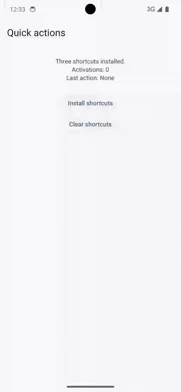

# quick_actions_kit

Home-screen quick actions for DartNative on iOS 15+ and Android API 26+.
Version **0.1.0**. See [VALIDATION.md](VALIDATION.md) for tested environments
and remaining qualification limits.

[DartNative catalogue](https://dartpub.dev/plugins/quick_actions_kit) · [Source repository](https://github.com/ManmohanTalwar/quick_actions_kit) · [Report an issue](https://github.com/ManmohanTalwar/quick_actions_kit/issues)

## Demo

Open the launcher menu, choose **New post**, and observe
`Last action: compose` with one activation. Recorded using the actual home-screen
menus on dedicated clean devices. Android starts with the shortcuts installed.
Only static waiting time is trimmed.

| iOS 26.5 simulator | Android 14 emulator |
|---|---|
|  |  |

## API

```dart
import 'package:quick_actions_kit/quick_actions_kit.dart';

// Your app calls generated DartNativePluginRegistrant.registerAll() first.
final actions = QuickActions();
await actions.initialize((type) {
  // Treat this as navigation intent; the app still validates session/permissions.
});
await actions.setShortcutItems([
  const ShortcutItem(type: 'compose', localizedTitle: 'New post', icon: 'ic_compose'),
]);
await actions.clearShortcutItems();
await actions.dispose(); // Stops delivery, does not clear shortcuts.
```

Install from the DartNative registry (the explicit host is required on DN 1.4.0):

```yaml
dependencies:
  quick_actions_kit:
    hosted: https://dartpub.dev
    version: ^0.1.0
```

For local development, see [the example instructions](example/README.md).
Each host owns its navigation and user policy. No Orb routes, accounts, credentials or private dependencies are included.

## Behaviour

- Dynamic replacement/clear; static and pinned shortcuts are separate OS concepts.
- One app-wide owner. Reinitializing replaces the handler without another native listener.
- Cold taps buffer until initialize; warm taps deliver through one native dispatcher.
  Repeated taps are independent events. The bounded native queue keeps the latest 32.
- Types/titles must be nonempty; types unique within an update. Values are copied
  before async mutation. Native failures propagate as QuickActionsException.
- iOS permits up to four requested dynamic items; static entries can reduce what
  the launcher displays. Subtitle is iOS-only. `icon` is an iOS template-image name
  or Android drawable/mipmap resource. Missing icon falls back to OS presentation.
- Android enforces the platform shortcut limit and reports rate-limit rejection.
- Main isolate only. Commands are serialized; a request times out after 15 seconds.
  A timeout means the outcome is uncertain, not that native execution was cancelled.
- New package, not an import-only migration: shortcut ids can be retained, but
  installed shortcuts should be refreshed on upgrade because the Android target
  activity changes. Pinned/static legacy entries require a separate migration policy.

## Native architecture

This is a **service plugin**, with no NativeElement or native rendered view.

- iOS: Dart FFI → Swift C ABI → UIKit. The public DN scene event hub handles initial
  and warm shortcut taps. Unsupported hub/callback APIs fail initialization.
- Android: Dart FFI → C++ JNI → Kotlin ShortcutManager. The pluginClass loads the
  shared library via the JVM. A manifest-provided no-display receiver forwards to
  the normal launcher and buffers cold input before engine initialization. No
  private framework-class dependency is required for standalone AAR packaging.
  Public Application lifecycle callbacks hold events until the launcher resumes.
- iOS registers one dispatcher slot; Android checks DN_IsolateGen before each
  callback. Queued requests carry generation/session identity. Native delivery
  stays on the main thread. A Dart lifecycle observer refreshes registration on
  resume, including activity recreation that retains the isolate. Request strings are copied; synchronous dispatcher
  strings stay native-owned only until Dart copies them. JNI uses UTF-8 bytes.

The Android receiver is exported because launchers invoke it. Its type string is
**untrusted input**, never login/payment authority. It carries no arbitrary URI,
file or intent target. App callbacks must validate their own route/session policy.

## Development

Initial qualification uses DartNative 1.4.0. Use `dn` and `dart` from the same
DartNative SDK installation; see VALIDATION.md for the pinned versions.

```sh
dn pub get
dart analyze lib test
dart test
cd example
dn pub get
dn build ios --simulator --debug
dn build apk --debug
```

The example was generated with `dn create --template plugin`. Register all
plugins before runApp. There are no manual application delegate edits or runtime
permissions to add. Test long-press launch, terminated launch, repeated taps,
clear, Unicode and hot restart on each platform before a release.

## Licence and provenance

Original code is licensed under [Apache-2.0](LICENSE). Attribution and upstream
licence texts are retained in [NOTICE](NOTICE) and
[THIRD_PARTY_NOTICES.md](THIRD_PARTY_NOTICES.md). See
[provenance.json](provenance.json) for the inspected sources and their use.

Published archives include LICENSE and collector-readable NOTICES. No DartNative
framework sources or vendor binaries are redistributed as source here.
