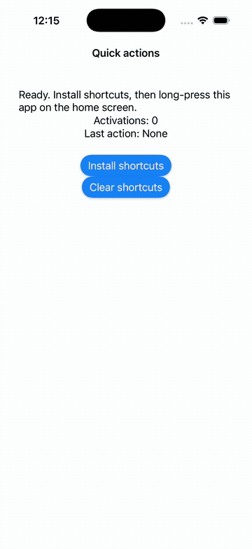

# quick_actions_kit

Home-screen quick actions for DartNative on iOS 15+ and Android API 26+.
Version **0.1.0**. See [VALIDATION.md](VALIDATION.md) for tested environments
and remaining qualification limits.

[Source repository](https://github.com/ManmohanTalwar/quick_actions_kit) · [Report an issue](https://github.com/ManmohanTalwar/quick_actions_kit/issues)

## Demo

Install shortcuts, open the launcher menu, choose **New post**, and observe
`Last action: compose` with one activation. Recorded on a clean iOS 26.5 simulator
using the actual home-screen menu.



## API

```dart
import 'package:quick_actions_kit/quick_actions_kit.dart';

// Your app calls generated DartNativePluginRegistrant.registerAll() first.
final actions = QuickActions();
await actions.initialize((type) {
  // Treat this as navigation intent; the app still validates session/permissions.
});
await actions.setShortcutItems([
  const ShortcutItem(type: 'compose', localizedTitle: 'New post', icon: 'ic_compose'),
]);
await actions.clearShortcutItems();
await actions.dispose(); // Stops delivery, does not clear shortcuts.
```

Install from the DartNative registry with `quick_actions_kit: ^0.1.0`.
For local development, see [the example instructions](example/README.md).
Each host owns its navigation and user policy. No Orb routes, accounts, credentials or private dependencies are included.

## Behaviour

- Dynamic replacement/clear; static and pinned shortcuts are separate OS concepts.
- One app-wide owner. Reinitializing replaces the handler without another native listener.
- Cold taps buffer until initialize; warm taps deliver through one native dispatcher.
  Repeated taps are independent events. The bounded native queue keeps the latest 32.
- Types/titles must be nonempty; types unique within an update. Values are copied
  before async mutation. Native failures propagate as QuickActionsException.
- iOS permits up to four requested dynamic items; static entries can reduce what
  the launcher displays. Subtitle is iOS-only. `icon` is an iOS template-image name
  or Android drawable/mipmap resource. Missing icon falls back to OS presentation.
- Android enforces the platform shortcut limit and reports rate-limit rejection.
- Main isolate only. Commands are serialized; a request times out after 15 seconds.
  A timeout means the outcome is uncertain, not that native execution was cancelled.
- New package, not an import-only migration: shortcut ids can be retained, but
  installed shortcuts should be refreshed on upgrade because the Android target
  activity changes. Pinned/static legacy entries require a separate migration policy.

## Native architecture

This is a **service plugin**, with no NativeElement or native rendered view.

- iOS: Dart FFI → Swift C ABI → UIKit. The public DN scene event hub handles initial
  and warm shortcut taps. Unsupported hub/callback APIs fail initialization.
- Android: Dart FFI → C++ JNI → Kotlin ShortcutManager. The pluginClass loads the
  shared library via the JVM. A manifest-provided no-display receiver forwards to
  the normal launcher and buffers cold input before engine initialization. No
  private framework-class dependency is required for standalone AAR packaging.
  Public Application lifecycle callbacks hold events until the launcher resumes.
- iOS registers one dispatcher slot; Android checks DN_IsolateGen before each
  callback. Queued requests carry generation/session identity. Native delivery
  stays on the main thread. A Dart lifecycle observer refreshes registration on
  resume, including activity recreation that retains the isolate. Request strings are copied; synchronous dispatcher
  strings stay native-owned only until Dart copies them. JNI uses UTF-8 bytes.

The Android receiver is exported because launchers invoke it. Its type string is
**untrusted input**, never login/payment authority. It carries no arbitrary URI,
file or intent target. App callbacks must validate their own route/session policy.

## Development

Initial qualification uses DartNative 1.4.0. Use `dn` and `dart` from the same
DartNative SDK installation; see VALIDATION.md for the pinned versions.

```sh
dn pub get
dart analyze lib test
dart test
cd example
dn pub get
dn build ios --simulator --debug
dn build apk --debug
```

The example was generated with `dn create --template plugin`. Register all
plugins before runApp. There are no manual application delegate edits or runtime
permissions to add. Test long-press launch, terminated launch, repeated taps,
clear, Unicode and hot restart on each platform before a release.

## Licence and provenance

Original code: Apache-2.0. See [LICENSE](LICENSE), [NOTICE](NOTICE),
[THIRD_PARTY_NOTICES.md](THIRD_PARTY_NOTICES.md) and [provenance.json](provenance.json).
No DartNative framework sources or vendor binaries are redistributed in source.

## Distribution notices

The official archive builder copies the synchronized extensionless
THIRD_PARTY_NOTICES bundle to NOTICES in both generated archives for licence
collectors. The notices are also reproduced below. Run
`python3 tool/check_distribution.py` when changing them. The complete native source, tests and validation record belong
to the public source repository; the builder's “source” archive contains Dart
bindings only.

<!-- BEGIN DISTRIBUTION NOTICES -->
quick_actions_kit
Copyright 2026 the quick_actions_kit contributors.
Original implementation is licensed under Apache-2.0.
Flutter API/behaviour references and their BSD-3-Clause licence are recorded in THIRD_PARTY_NOTICES.md.
DartNative and vendor SDKs retain their own licences and are not relicensed or redistributed as source here.

# Third-party notices

This package was scaffolded with the DartNative 1.4.0 official plugin template and
implemented against its public plugin/callback guides. No framework runtime
source or binaries are included in source distribution.

Flutter quick_actions 1.1.0, quick_actions_android 1.0.18 and
quick_actions_ios 1.2.5 were read for API and behaviour reference. The new bridge
and native implementation are original. Preserve the following attribution and
licence when adapting any of that implementation further; do not replace it with
Apache-2.0. The files and hashes inspected are in provenance.json.

## Flutter authors — BSD-3-Clause

Copyright 2013 The Flutter Authors. All rights reserved.

Redistribution and use in source and binary forms, with or without modification,
are permitted provided that the following conditions are met:

    * Redistributions of source code must retain the above copyright
      notice, this list of conditions and the following disclaimer.
    * Redistributions in binary form must reproduce the above
      copyright notice, this list of conditions and the following
      disclaimer in the documentation and/or other materials provided
      with the distribution.
    * Neither the name of Google Inc. nor the names of its
      contributors may be used to endorse or promote products derived
      from this software without specific prior written permission.

THIS SOFTWARE IS PROVIDED BY THE COPYRIGHT HOLDERS AND CONTRIBUTORS "AS IS" AND
ANY EXPRESS OR IMPLIED WARRANTIES, INCLUDING, BUT NOT LIMITED TO, THE IMPLIED
WARRANTIES OF MERCHANTABILITY AND FITNESS FOR A PARTICULAR PURPOSE ARE
DISCLAIMED. IN NO EVENT SHALL THE COPYRIGHT OWNER OR CONTRIBUTORS BE LIABLE FOR
ANY DIRECT, INDIRECT, INCIDENTAL, SPECIAL, EXEMPLARY, OR CONSEQUENTIAL DAMAGES
(INCLUDING, BUT NOT LIMITED TO, PROCUREMENT OF SUBSTITUTE GOODS OR SERVICES;
LOSS OF USE, DATA, OR PROFITS; OR BUSINESS INTERRUPTION) HOWEVER CAUSED AND ON
ANY THEORY OF LIABILITY, WHETHER IN CONTRACT, STRICT LIABILITY, OR TORT
(INCLUDING NEGLIGENCE OR OTHERWISE) ARISING IN ANY WAY OUT OF THE USE OF THIS
SOFTWARE, EVEN IF ADVISED OF THE POSSIBILITY OF SUCH DAMAGE.
<!-- END DISTRIBUTION NOTICES -->
